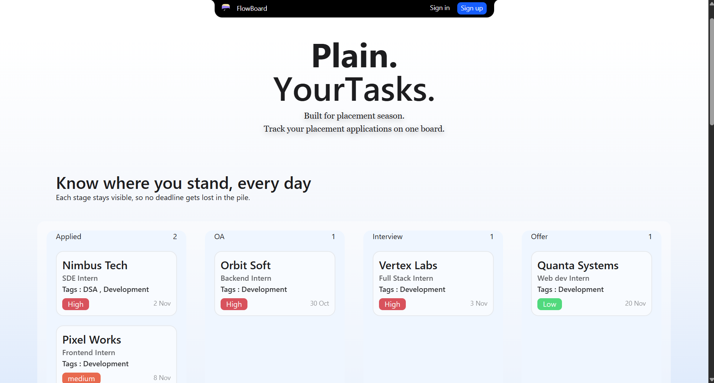
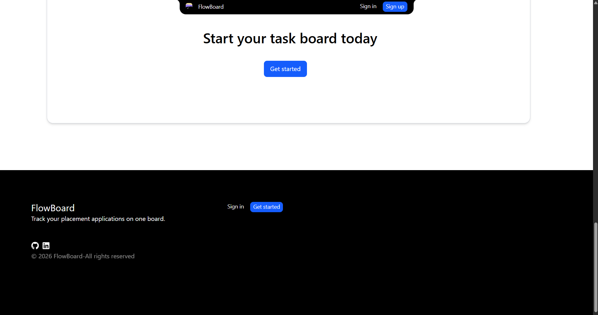
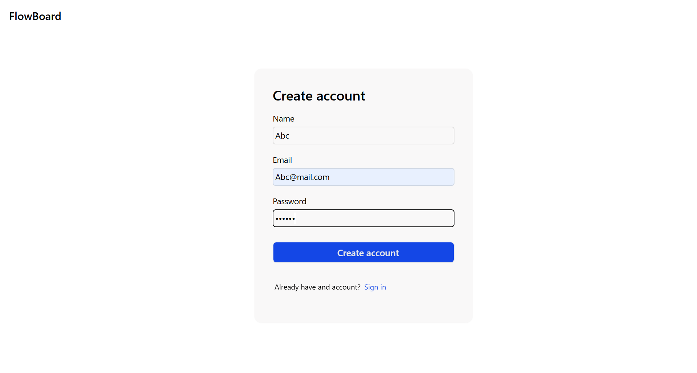
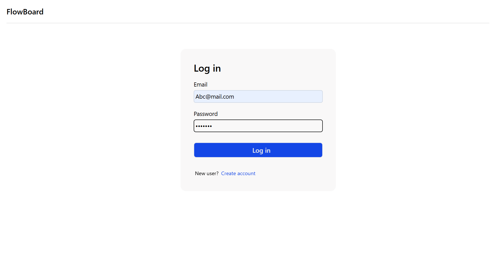

# Flowboard – Kanban Task Management Application

Flowboard is a Kanban-style task management application built to organize tasks through boards and columns.

I started building this project to get practical experience with full-stack development, authentication, REST APIs, and database management.

The application allows users to create an account, manage their boards, and organize tasks through different stages.

## Features

- **User Authentication:** Users can register and log in to their accounts.
- **Automatic Board Creation:** A default board with five columns is created when a new user signs up.
- **Kanban Board:** Organize tasks into different columns.
- **User-Specific Boards:** Each user can access their own boards.
- **Task Management:** Add tasks to boards and organize them by company, role, tags, and due date.
- **Board View:** View the columns and tasks belonging to a selected board.
- **Protected Routes:** Authentication middleware protects board-related API routes.

## Screenshots

### Home Page



### Home Page



### Signup Page



### Signin Page



## Default Board Columns

Each new user gets a default placement board with these five columns:

1. Applied
2. OA
3. Interview
4. Offer
5. Reject

## Tech Stack

**Frontend**

- React.js
- JavaScript
- Tailwind CSS
- React Router

**Backend**

- Node.js
- Express.js
- REST APIs

**Database**

- MongoDB
- Mongoose

**Authentication & Security**

- JSON Web Token (JWT)
- Bcrypt
- Cookie-based authentication

**Tools**

- Git
- GitHub
- Nodemon
- Dotenv

## Project Structure

```text
Flowboard/
│
├── Backend/
│   ├── Controller/
│   ├── middleware/
│   ├── Models/
│   ├── Routes/
│   ├── service/
│   ├── utils/
│   ├── connection.js
│   ├── index.js
│   └── package.json
│
├── Frontend/
│
└── README.md
```

## Backend API Routes

| Method | Endpoint             | Description                                       |
| ------ | -------------------- | ------------------------------------------------- |
| POST   | /api/auth/signup     | Register a new user                               |
| POST   | /api/auth/login      | Log in a user                                     |
| GET    | /api/boards          | Fetch user's boards                               |
| GET    | /api/board/:id       | Fetch a specific board with its columns and tasks |
| POST   | /api/board/:id/tasks | Add a task to a board                             |

## Getting Started

### Prerequisites

- Node.js
- npm
- MongoDB or MongoDB Atlas

### 1. Clone the repository

```bash
git clone https://github.com/PrateekTailor/Flowboard.git
```

### 2. Navigate to the backend directory

```bash
cd Flowboard/Backend
```

### 3. Install backend dependencies

```bash
npm install
```

### 4. Configure environment variables

Create a `.env` file inside the Backend directory.

Add the following variables:

```env
MONGO_URI=your_mongodb_connection_string
PORT=5000
```

Replace the MongoDB placeholder with your own connection string.

### 5. Start the backend server

```bash
npm start
```

The backend will run on the port configured in your `.env` file.

### 6. Frontend Setup

Navigate to the Frontend directory and install its dependencies.

```bash
cd ../Frontend
npm install
```

Start the frontend using the development script configured in its package.json.

## Current Development Status

- Backend authentication implemented.
- Automatic default board creation implemented.
- User-specific board fetching implemented.
- Board and task retrieval APIs implemented.
- Task creation API implemented.
- React frontend interfaces developed.
- Frontend and backend data integration is in progress.
- Deployment is pending.

## Future Improvements

- Complete frontend and backend integration.
- Implement and verify remaining board and task operations.
- Improve error handling and loading states.
- Deploy the application.

## Author

**Prateek Tailor**

GitHub: [PrateekTailor](https://github.com/PrateekTailor)
